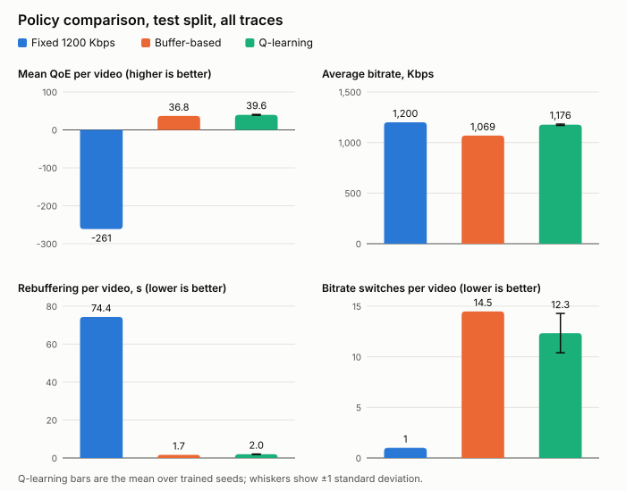
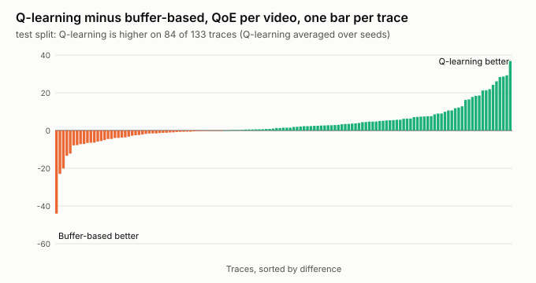
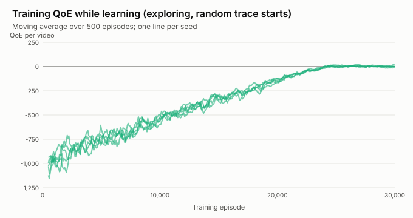

# Tabular Q-learning agent

This document describes the Q-learning bitrate policy, how it was trained and
tuned, and the frozen comparison against the two baselines on the test split.
Everything here can be regenerated with the commands in
[Reproducing the results](#reproducing-the-results); no third-party Python
packages are needed.

## Problem setup

Each video has 49 chunks of 4 seconds. Before downloading a chunk the player
chooses one of six bitrates (300, 750, 1200, 1850, 2850, 4300 Kbit/s). The
reward for that chunk is the shared linear QoE from `qoe.py`, unchanged from
the baselines (MERINA / Pensieve linear QoE):

```text
reward = bitrate_Mbps - 4.3 * rebuffer_s - |bitrate_Mbps - previous_bitrate_Mbps|
```

The rebuffering weight equals the top bitrate, so one second of stalling
cancels the quality gain of the best chunk.

## Agent design

`src/abr_simulator/policies/q_learning.py`

| Element | Choice |
| --- | --- |
| State | (throughput bin, buffer bin, previous bitrate index) |
| Throughput | Harmonic mean of the last *h* measured chunk throughputs, binned by fixed Mbit/s edges, plus one extra bin for the first chunk (nothing measured yet) |
| Buffer | Seconds of buffered video before the request, binned by fixed edges |
| Action | Bitrate index of the next chunk (6 actions) |
| Update | `Q(s,a) += alpha * (r + gamma * max_a' Q(s',a') - Q(s,a))`; the last chunk uses target `r` |
| Exploration | epsilon-greedy, epsilon decays linearly from 1.0 to 0.01 over a fraction of training, then stays at 0.01 |
| Evaluation | Greedy (epsilon = 0); ties and unvisited states choose the lowest bitrate |
| Initial Q | 0 for every state-action pair |

Every measurement in the state is available to a real player before it
requests a chunk. The agent never reads future trace values. Q-learning is
off-policy: it learns the greedy policy from the `max` target even though the
behaviour during training is exploratory.

**Training episodes.** Each episode picks one of the 166 training traces at
random and a random start position inside it, then plays a full 49-chunk
video while updating the table online. Random starts let the agent see many
different stretches of each trace. Evaluation, like the baseline scripts,
plays each trace once from its start.

## Hyperparameter tuning (validation only)

`scripts/tune_q_learning.py` trains every configuration with several seeds
on the training split and scores the greedy agent by mean validation QoE per
video, averaged over seeds. The test split is never loaded during tuning.

Bin presets (edges; values on an edge fall in the upper bin):

| Preset | Throughput edges (Mbit/s) | Buffer edges (s) | States |
| --- | --- | --- | ---: |
| coarse | 0.8, 1.6, 3.0 | 5, 12, 25 | 144 |
| medium | 0.5, 1.0, 1.5, 2.2, 3.2 | 4, 8, 12, 18, 26 | 288 |
| fine | 0.4, 0.7, 1.0, 1.4, 1.9, 2.6, 3.5 | 2, 4, 7, 10, 14, 19, 26, 35 | 486 |

Throughput edges roughly follow the training-trace bandwidth quantiles.
Buffer edges are denser at low buffer, where rebuffering risk is highest.

The search ran coarse-to-fine in two rounds. Each round has a stage 1 grid
over structure and learning rule, then a stage 2 sweep of the training
schedule (episodes and epsilon decay) for the best stage 1 configuration.

| Round | Grid | Seeds | Best validation QoE |
| --- | --- | ---: | ---: |
| 1 | bins {coarse, medium, fine} x alpha {0.05, 0.1, 0.2} x gamma {0.8, 0.9, 0.99} x history {1, 3}; then episodes {10k, 30k, 100k} x decay {0.5, 0.8} | 3 | 44.30 |
| 2 | bins {medium, fine} x alpha {0.02, 0.05, 0.1} x gamma {0.5, 0.65, 0.8, 0.9} x history {1, 3}; then episodes {30k, 100k, 200k} x decay {0.5, 0.8} | 5 | 46.48 |

Round 1's best configuration sat on the edge of its grid (smallest learning
rate, smallest discount, finest bins), so round 2 extended the grid past that
edge and dropped values that were clearly worse (coarse bins, alpha 0.2,
gamma 0.99). Full tables are in `results/q_learning/tuning_round1.csv` and
`results/q_learning/tuning.csv`.

Observations from the search:

- **Finer bins helped** throughout: every top-10 configuration uses the fine
  preset.
- **Smaller learning rates were better and more stable.** With the noisy
  rewards of real traces, alpha 0.2 was consistently worse.
- **Short horizons won.** gamma 0.99 was the worst value in round 1, and the
  best configurations use gamma between 0.5 and 0.8. With only 49 chunks and
  a reward dominated by the immediate rebuffering penalty, long-horizon
  bootstrapping mostly adds variance.
- **Throughput smoothing over 3 chunks** helped slightly at the best
  settings.
- The top few configurations are within one seed standard deviation of each
  other (about +/-1 to 2 QoE), so the exact winner is not sharply determined.
  Round 2's winner is still on the grid edge (alpha 0.02, gamma 0.5). We
  stopped because the remaining differences are inside seed noise.

**Selected configuration** (`results/q_learning/best_hyperparameters.json`):
fine bins, alpha = 0.02, gamma = 0.5, throughput history = 3, 30,000
episodes, epsilon decayed over the first 80% of training.

For reference, the declared baselines on validation score 43.94
(buffer-based) and -230.68 (fixed 1200 Kbit/s). Retraining the selected
configuration with the five fresh final seeds gives 47.88 +/- 1.87 on
validation (`results/final/validation/summary.md`).

## Final comparison (test split, run once)

`scripts/evaluate_final.py --split test` retrained the frozen configuration
with five new seeds (100 to 104, none used in tuning) and evaluated each
agent and both declared baselines on the 133 test traces. Q-learning cells
are mean +/- standard deviation across the five agents.

### All test traces (133)

| Policy | Mean QoE per video | Avg bitrate (Kbps) | Rebuffer per video (s) | Switches per video |
|---|---|---|---|---|
| Fixed 1200 Kbps | -261.37 | 1200 | 74.35 | 1.00 |
| Buffer-based (10 s / 40 s) | 36.78 | 1069 | 1.66 | 14.48 |
| **Q-learning** | **39.64 ± 1.10** | 1176 ± 7 | 1.97 ± 0.11 | 12.34 ± 1.95 |

### By trace source

| Source | Buffer-based QoE | Q-learning QoE | Paired difference (95% CI) | Traces where Q-learning is higher |
|---|---:|---:|---:|---:|
| FCC (45) | 38.29 | 44.44 ± 1.03 | +6.16 [+3.65, +8.61] | 40 of 45 |
| HSDPA (88) | 36.01 | 37.19 ± 1.15 | +1.18 [-0.88, +3.29] | 44 of 88 |
| All (133) | 36.78 | 39.64 ± 1.10 | +2.86 [+1.23, +4.51] | 84 of 133 |

The paired difference is the per-trace QoE of Q-learning (averaged over the
five seeds) minus buffer-based, averaged over traces. The interval is a
percentile bootstrap over traces (10,000 resamples, seed 0). Full per-trace
results are in `results/final/test/per_trace.csv`.

### Figures







The training curve shows QoE *during* training. It stays below the evaluation
scores because it includes exploration, random start positions, and the
training traces, which are harder than the held-out ones (on the training
split the buffer-based baseline scores 20.5 and a greedy Q-learning agent
22.7).

## Discussion

- **Q-learning beats both baselines on mean QoE**, by about 2.9 per video
  (8%) over buffer-based on test. Across five independently trained agents
  the spread is about +/-1.1, smaller than the gap.
- **It wins by choosing higher bitrates and switching less**, while
  rebuffering slightly more (about 0.3 s more per video). Because it sees
  throughput, it can raise the bitrate before the buffer fills. The
  buffer-based policy has to wait for the buffer to reach its thresholds.
- **The gain comes mostly from FCC traces** (+6.2, higher on 40 of 45).
  On HSDPA mobile traces the two policies are statistically tied. Those
  traces fluctuate quickly, so last-chunk throughput predicts the next
  chunk less well.
- **The fixed 1200 Kbit/s baseline fails badly** on these splits because
  many traces cannot sustain 1.2 Mbit/s, which causes more than a minute of
  stalling per video.

## Limitations

- Tabular states lose information. The agent does not see the upcoming
  chunk sizes, the remaining chunks, or throughput variance. About 35% of
  the 486 fine-bin states are never visited in training and fall back to the
  lowest bitrate.
- Tuning differences near the top are within seed noise, and the selected
  values are on the edge of the round 2 grid.
- The baselines use their declared, untuned defaults, as required by
  `docs/BASELINES.md`. A buffer-based policy tuned on validation would be a
  stronger comparison.
- Every result comes from the simulator with one video (Mao chunk sizes).

## Simulator fix included with this work

The tuning run exposed a rare floating-point edge case in
`ABREnvironment`. When a partial download (or a buffer-full sleep) ended
exactly on a trace timestamp, the next step found a zero-length interval and
raised `RuntimeError: trace interval did not advance`. It occurred about
once in 170,000 random-start episodes. The environment now advances to the
next interval in that case, and `tests/test_simulator.py` has a regression
test using the real trace that triggered it. Re-running both baselines on
all three splits gives bit-for-bit identical metrics before and after the
fix.

## Reproducing the results

```bash
PYTHONPATH=src python3 -m unittest discover -s tests -v

python3 scripts/tune_q_learning.py --round 1        # ~10 min on 4 cores
python3 scripts/tune_q_learning.py                  # round 2, ~20 min; writes best_hyperparameters.json

python3 scripts/evaluate_final.py --split validation   # optional sanity check
python3 scripts/evaluate_final.py --split test         # final, run once
python3 scripts/make_figures.py --split test
```

To train a single agent with custom settings:

```bash
python3 scripts/train_q_learning.py --hyperparameters results/q_learning/best_hyperparameters.json --seed 0
```
