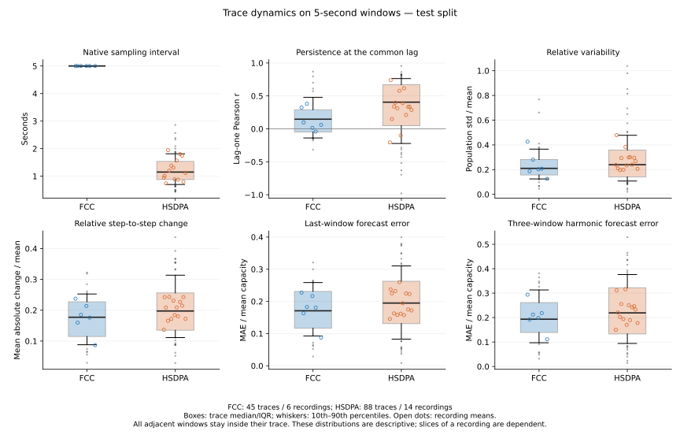
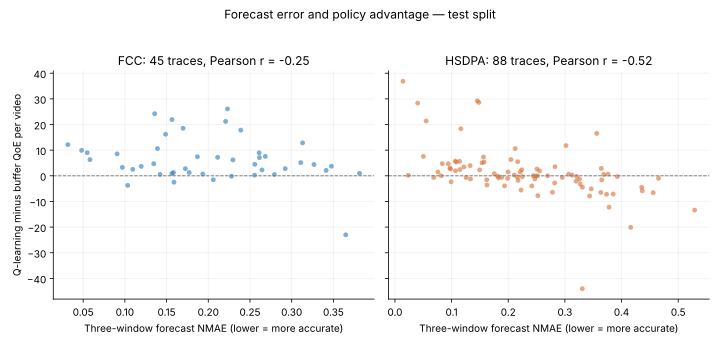

# Trace dynamics analysis

## Question and scope

The frozen experiments find a larger Q-learning advantage over buffer-based
adaptation on FCC than HSDPA. One possible explanation is that recent
throughput is more informative on FCC. This analysis checks the data behind
that explanation: how variable is bandwidth, how persistent are adjacent
values, and how accurately do simple causal forecasts predict the next value?

This is a descriptive follow-up after final evaluation. It uses the existing
166 training, 129 validation, and 133 test traces separately, and reads saved
QoE results where available. It performs no policy training, hyperparameter
selection, or new policy evaluation. Test findings should inform the report's
interpretation, not further model selection.

## Reproduce the tables and figures

From the repository root, generate all numerical outputs with the Python
standard library:

```bash
python3 scripts/analyze_trace_dynamics.py
```

Report figures use Matplotlib as an optional plotting dependency. Install it
in a virtual environment, then generate the test figure pair:

```bash
python3 -m venv .venv
.venv/bin/python -m pip install -r requirements-analysis.txt
.venv/bin/python scripts/plot_trace_dynamics.py --split test
```

The plot script also accepts `--split train` or `--split validation`.
Figures are saved as SVG, PDF, and PNG. Use the PDF/SVG versions in the report.
The numerical results are reproducible without Matplotlib or NumPy.

For a different timescale, use a separate output directory:

```bash
python3 scripts/analyze_trace_dynamics.py --window-seconds 10 --output-dir /tmp/abr-trace-dynamics-10s
```

The window is an analysis timescale, not a parameter of the trained policy.
The included results use 5 seconds, selected from the data's sampling rates.

## Sampling and preprocessing

FCC samples occur every 5 seconds, while HSDPA samples are irregular and
typically about 1 second apart. Comparing native lag-one correlations would
therefore compare different elapsed times. We retain native statistics for
inspection but calculate the main metrics on the same 5-second grid.

For each trace, `trace_dynamics.py` integrates the piecewise-constant
bandwidth function over nonoverlapping 5-second windows, starting at that
trace's first timestamp. It follows the simulator convention: bandwidth at
row `i` applies to the interval `(time[i-1], time[i]]`. Row zero has no
preceding interval and is excluded. Integration weights each interval by its
duration rather than treating irregularly spaced samples as equally long.

The analysis preserves outages with bandwidth zero. It does not repeat the
trace, cross file boundaries, interpolate between values, or concatenate
slices. Any incomplete last window is discarded; its length is recorded in
`discarded_tail_s`. Nonzero starting timestamps are supported.

FCC's original observations are already averaged over relatively long
intervals. This common grid makes the modeled elapsed time comparable; it
cannot recover unobserved variation within an FCC sample.

## Metric definitions

Let `x[0], ..., x[n-1]` be a trace's window-averaged bandwidths in Mbit/s,
and let `mu` be their arithmetic mean.

| Metric | Definition | Meaning |
| --- | --- | --- |
| Lag-one correlation | Pearson correlation of `x[:-1]` and `x[1:]` | Temporal persistence across 5 seconds; larger means stronger positive linear association |
| Mean absolute change | Mean of `abs(x[t] - x[t-1])` | Absolute bandwidth changes in Mbit/s |
| Normalized absolute change | Mean absolute change divided by `mu` | Changes relative to each trace's bandwidth scale |
| Coefficient of variation (CV) | Population standard deviation divided by `mu` | Overall relative variability within the trace |
| Forecast MAE | Mean of `abs(prediction[t] - x[t])` | Error of a specific next-window predictor, in Mbit/s |
| Forecast NMAE | Forecast MAE divided by `mu` | Scale-normalized forecast error; lower is better |

Correlation is undefined for constant series or fewer than three paired
observations. Normalized statistics are undefined if the mean is zero. Such
entries are CSV blanks and JSON `null`, not fabricated zeros. Every summary
records its valid observation count.

### Causal prediction comparison

The one-window predictor is `prediction[t] = x[t-1]`. The three-window
predictor is the harmonic mean of `x[t-3:t]`, using the same `1e-9` numerical
floor for zeros as the agent. Both are scored starting at the fourth window,
so they face exactly the same targets and use only previously observed data.
Normalization uses the entire trace's mean for descriptive scoring; that mean
is never provided to a predictor.

NMAE avoids per-target division by zero. A value of 0.20 means that average
absolute error equals 20% of that trace's mean bandwidth, not a 20% error on
every individual prediction.

These are raw link-capacity forecasts at fixed time intervals. The Q-learning
agent observes completed chunk throughput, affected by its selected chunk
size, 95% payload efficiency, RTT, and variable download duration. Three
5-second windows span 15 seconds; three chunk measurements span a variable
duration. This study is therefore a proxy for information quality, not a
direct accuracy measurement of the agent's throughput feature.

## Aggregation and dependent slices

The primary summary gives every trace file equal weight, matching the final
QoE experiment's unit. It reports mean, median, standard deviation, and
25th/75th percentiles separately for each split and source.

Holdout trace slices from the same original recording are dependent. The test
split has 45 FCC slices from only 6 recordings and 88 HSDPA slices from 14
recordings. A second aggregation first averages metrics across slices of a
recording, then weights each recording equally. Those results are in
`per_recording.csv` and the `unit=recording` rows of `summary.csv`.

The source-comparison figure shows trace distributions and recording means.
It does not depict confidence intervals or treat the 133 slices as independent
experimental units. Correlations with saved QoE are descriptive associations;
they do not control for bandwidth level, source, or other confounders.

Seven short HSDPA validation slices have fewer than four complete windows.
They remain in the data and in metrics that are defined, but are omitted from
forecast and lag-correlation summaries. All test slices support these metrics.

## Results and interpretation

The table below contains **medians across test trace files**, not pooled
samples or medians across whole recordings. Complete train/validation/test
tables and valid counts are in [the generated summary](../results/trace_dynamics/summary.md).

| Test metric | FCC (45 traces) | HSDPA (88 traces) |
| --- | ---: | ---: |
| Lag-one correlation at 5 seconds | 0.147 | 0.405 |
| Coefficient of variation | 0.210 | 0.240 |
| Normalized absolute change | 0.177 | 0.197 |
| One-window forecast NMAE | 0.171 | 0.195 |
| Three-window harmonic forecast NMAE | 0.193 | 0.219 |



The evidence is mixed rather than a blanket finding that FCC is more
predictable. **HSDPA has higher positive autocorrelation**, contradicting the
earlier proposed explanation that FCC would have greater persistence.
However, FCC has somewhat lower relative variability, normalized change, and
forecast error. A series can be highly correlated while its changes remain
large: persistence and prediction error measure different properties.

The three-window harmonic predictor has higher median error than the
one-window predictor in both sources. More smoothing is not automatically
better at predicting the next 5-second interval; it can lag changes. This does
not contradict the tuned agent's slight validation benefit from a three-chunk
history: that experiment scores QoE from policy decisions, not forecast error
on a fixed-time bandwidth sequence.

### Relation to the already measured policy advantage

For each validation/test trace, the script reads the existing per-trace QoE,
averages Q-learning over the five saved seeds, and subtracts buffer-based QoE.
It then pairs that difference with the trace statistics. No policy is rerun.



Across the 133 test slices, three-window NMAE correlates negatively with the
saved QoE gain (`r = -0.464`). The association also appears when first averaging
within recordings (`r = -0.628`, 20 recording means). This is consistent with
larger benefits when the recent-throughput proxy is more accurate, but does
not establish that prediction quality causes the gain.

Alternative explanations remain: mean bandwidth also correlates with gain
(`r = +0.571` across test slices), while CV correlates negatively
(`r = -0.585`). Higher-capacity or lower-variation traces might simply offer
more opportunity to increase video quality relative to the fixed buffer rule.
Source-wise and recording-wise associations are saved in
`qoe_associations.csv`; only six FCC test recordings limit broad conclusions.

A defensible report interpretation is that the modest source difference in
forecast error is consistent with, but does not fully explain, the larger FCC
QoE improvement. Do not state that FCC has higher autocorrelation or that the
analysis proves a causal mechanism. Per-trace policy timelines would provide
additional evidence about the actual decisions behind wins and losses.

## Output inventory and provenance

All outputs are under `results/trace_dynamics/`:

| File | Purpose |
| --- | --- |
| `per_trace.csv` | One row per trace; sampling, dynamics, forecast errors, and saved QoE gain |
| `per_recording.csv` | One row per original recording, averaging its slice metrics |
| `summary.csv` / `summary.json` | Long-format statistics by split, source, metric, and aggregation unit |
| `summary.md` | Readable source comparison tables and missing-value counts |
| `qoe_associations.csv` | Pearson associations with frozen QoE differences, with pair counts |
| `metadata.json` | Settings, seed IDs from saved results, and SHA-256 fingerprints of inputs |
| `figures/test_source_comparison.*` | Six sampling/dynamics/prediction panels |
| `figures/test_qoe_relationship.*` | Forecast error versus saved QoE advantage by source |

Implementation: `src/abr_simulator/trace_dynamics.py` and
`scripts/analyze_trace_dynamics.py`. Tests verify time weighting, interval
semantics, matching forecast targets, outages, constants, and short traces.
