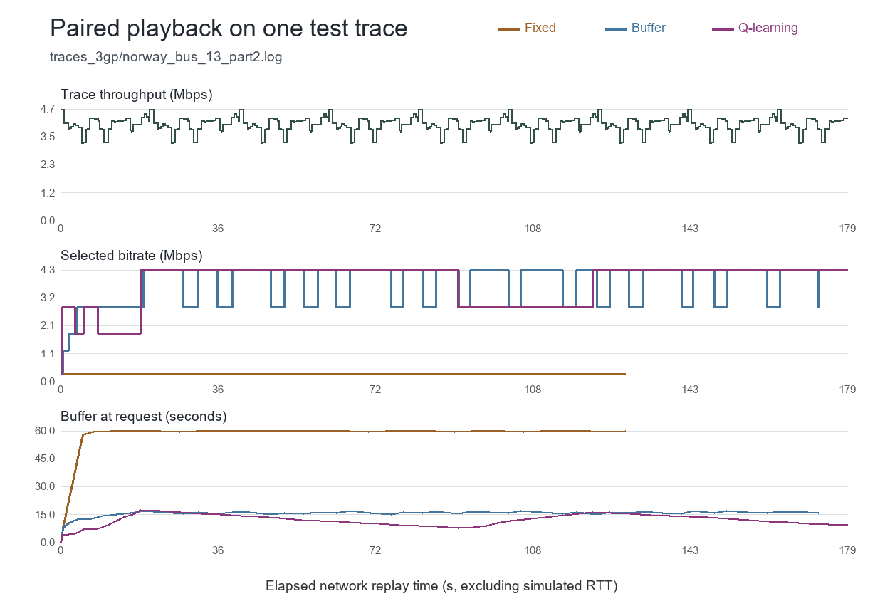

# Experiment Report

## Research question

Can a tabular Q-learning agent that observes completed downloads achieve higher Quality of Experience (QoE) than fixed-bitrate and buffer-based policies on the same video and network traces? This report documents one completed local simulation run.

## Data sources and processing

The [bandwidth repository](https://github.com/confiwent/Real-world-bandwidth-traces/tree/d28c4fd48d0e358db024cc0217b111c070815fa7) provides processed timestamps in seconds and throughput in Mbps. We inspected fcc_ori/ and traces_3gp/. The FCC directory contains both FCC-numbered captures and commute files named after transport modes. HSDPA files follow the norway_<transport>_<capture>_partN naming convention.

| Source | Files inspected | Excluded | Training | Validation | Test |
|---|---:|---:|---:|---:|---:|
| FCC-numbered records | 196 | 137 | 41 | 9 | 9 |
| HSDPA in traces_3gp | 144 | 0 | 102 | 24 | 18 |
| Non-FCC commute records in fcc_ori | 329 | 329 | 0 | 0 | 0 |

The audit retained 203 of 669 files. FCC exclusions include 132 slices matched row-for-row to complete captures and five duplicates. Each record must have two finite numeric columns, strictly increasing timestamps, nonnegative throughput, and at least one interval with positive throughput. Valid zero-throughput intervals remain. Timestamps are shifted to start at zero. The [manifest](results/run_01/manifest.csv) records source, duration, capture group, fingerprint, exclusion reason, and split.

Within each source, capture groups are shuffled with seed 42 and assigned in descending group-size order to the split with the largest remaining trace-count quota. The target proportions are 70%/15%/15%. FCC has 41/9/9 capture groups in training/validation/test; HSDPA has 17/4/3 groups, each with six slices. Duplicate normalized records and capture groups spanning splits are checked. Existing upstream directory names such as test_traces do not determine this experiment's split. Metrics weight traces equally, so slices within a capture may remain correlated.

## Playback and observations

The experiment directly calls the [deterministic MERINA player](https://github.com/confiwent/merina/blob/dfd01b7f664e3a9fa0d123945081f7af2ebb31f7/envs/fixed_env_log.py) with the six Mao chunk-size files from the same revision. All policies start the same 49-chunk video at the beginning of the same trace with an empty buffer. The player uses four-second chunks, a 95% payload fraction, 80 ms RTT, a 60-second buffer limit, and cyclic replay of short traces. Different download sizes cause policies to reach later network conditions at different times.

The first chunk uses 0.30 Mbps and has no switching penalty. Subsequent states contain the previous measured-throughput bin, buffer bin before the decision, and previous bitrate index. Measured throughput is the completed chunk's size in Mbit divided by download seconds, including RTT and excluding voluntary waiting.

Throughput boundaries are 0.75, 1.20, 1.85, 2.85, and 4.30 Mbps. Buffer boundaries are 4, 8, 16, and 32 seconds. Values exactly on a boundary enter the higher bin. There are 180 states with six bitrate actions: 0.30, 0.75, 1.20, 1.85, 2.85, and 4.30 Mbps.

## Reward and policies

For chunk t, the reward is:

```text
reward_t = bitrate_t - 4.3 * rebuffer_seconds_t - abs(bitrate_t - bitrate_previous)
```

Bitrate is in Mbps. Initial startup waiting counts as rebuffering for all policies. The first switching penalty is zero. Bitrate levels and reward weights follow the [MERINA parameters](https://github.com/confiwent/merina/blob/dfd01b7f664e3a9fa0d123945081f7af2ebb31f7/main.py).

- Fixed bitrate is selected from all six rates by average validation-trace QoE. The selected rate was 0.30 Mbps.
- The buffer rule selects the minimum rate at or below four seconds and the maximum at or above 16 seconds. Between these thresholds, it interpolates a target rate linearly and rounds down to the available rate.
- Q-learning initializes all Q-values to zero, traverses shuffled training traces once per epoch, and uses learning rate 0.1 and discount factor 0.95. Exploration in epoch e is max(0.05, 0.5 * 0.92^(e-1)). Ties choose the lower bitrate. Terminal updates omit future value. The forced first chunk does not update the regular state table. Validation compares epochs 1, 3, 6, 12, 24, and 40 and selects epoch 12. Test evaluation disables exploration and freezes Q-values.

## Results

For each playback, we calculate mean per-chunk QoE, mean bitrate, total rebuffering seconds, and mean absolute bitrate change over the 48 adjacent-chunk transitions. We then average these per-trace metrics within each source.

| Source | Policy | Mean QoE | Mean bitrate (Mbps) | Rebuffering (s/video) | Mean switch (Mbps) |
|---|---|---:|---:|---:|---:|
| FCC | Fixed | 0.083 | 0.300 | 2.468 | 0.000 |
| FCC | Buffer | 0.223 | 1.134 | 6.506 | 0.347 |
| FCC | Q-learning | 0.597 | 1.075 | 2.566 | 0.257 |
| HSDPA | Fixed | 0.209 | 0.300 | 1.039 | 0.000 |
| HSDPA | Buffer | 1.070 | 1.771 | 3.150 | 0.433 |
| HSDPA | Q-learning | 1.342 | 1.753 | 1.070 | 0.323 |

Under the chosen reward weights, Q-learning had the highest average QoE on both test sources. The buffer policy achieved slightly higher average bitrate, with more rebuffering and larger bitrate changes.

The illustrative trace, norway_bus_13_part2.log, was selected by the largest QoE spread among policies. All three policies incurred 0.410 seconds of rebuffering. At chunks 17-22, the buffer policy repeatedly crossed its 16-second threshold and alternated between 2.85 and 4.30 Mbps. Q-learning maintained 4.30 Mbps over that portion, then reduced to 2.85 Mbps at chunk 26 with 7.71 seconds remaining in its buffer. Trace-level QoE was 0.264 for fixed, 2.367 for buffer, and 3.305 for Q-learning.



The chart uses elapsed network replay time, excluding simulated RTT. Buffer lines connect observations at download decisions. Exact values are in [case_chunks.csv](results/run_01/case_chunks.csv).

## Limitations and TA discussion

The test set includes nine FCC capture groups and only three HSDPA groups, one video, and one training seed. Short traces may loop. The player models rebuffering, and linear QoE approximates viewing experience. These results describe this split and configuration. Broader conclusions require additional network conditions, videos, and training seeds.

Discuss whether throughput bins aligned with bitrate choices are appropriate and whether the per-source paired analysis is sufficient given the small number of HSDPA test captures.

## Verification and reproduction

From the repository root, use Python with NumPy, Pillow, and Git. Fetch the pinned dependencies using the steps in [README.md](README.md).

```powershell
python prototype/src/experiment.py --out prototype/results/run_replay
```

Use a fresh output directory. Repository revisions are recorded in [selection.json](results/run_01/selection.json) and checked out under prototype/upstream/. The causal check fixes the first nine downloads and changes future bandwidth for each policy. It verifies that the tenth action remains identical while the resulting download duration changes. A separate check verifies that test evaluation leaves the Q-table unchanged.

| Artifact | Purpose |
|---|---|
| [manifest.csv](results/run_01/manifest.csv) | Per-file audit, exclusions, capture IDs, and splits |
| [counts.csv](results/run_01/counts.csv) | Data counts by source and split |
| [validation.csv](results/run_01/validation.csv) | All fixed-rate and checkpoint validation scores |
| [q_table.npy](results/run_01/q_table.npy) | Selected Q-table |
| [per_trace.csv](results/run_01/per_trace.csv) | Metrics for all 81 test playbacks |
| [summary.csv](results/run_01/summary.csv) | Metrics aggregated by source and policy |

Generative AI assisted with the prototype implementation, checks, documentation, and repository migration. This historical prototype is shared for team review and adaptation before use in a course submission.
